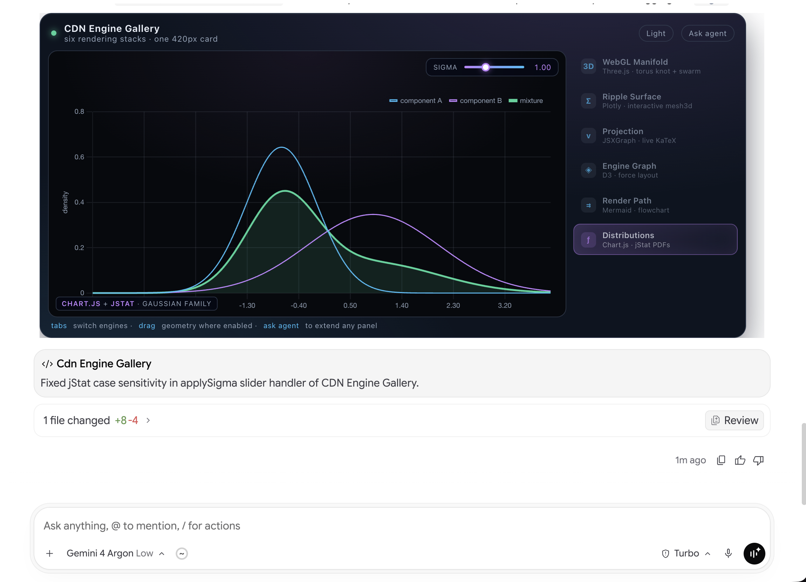
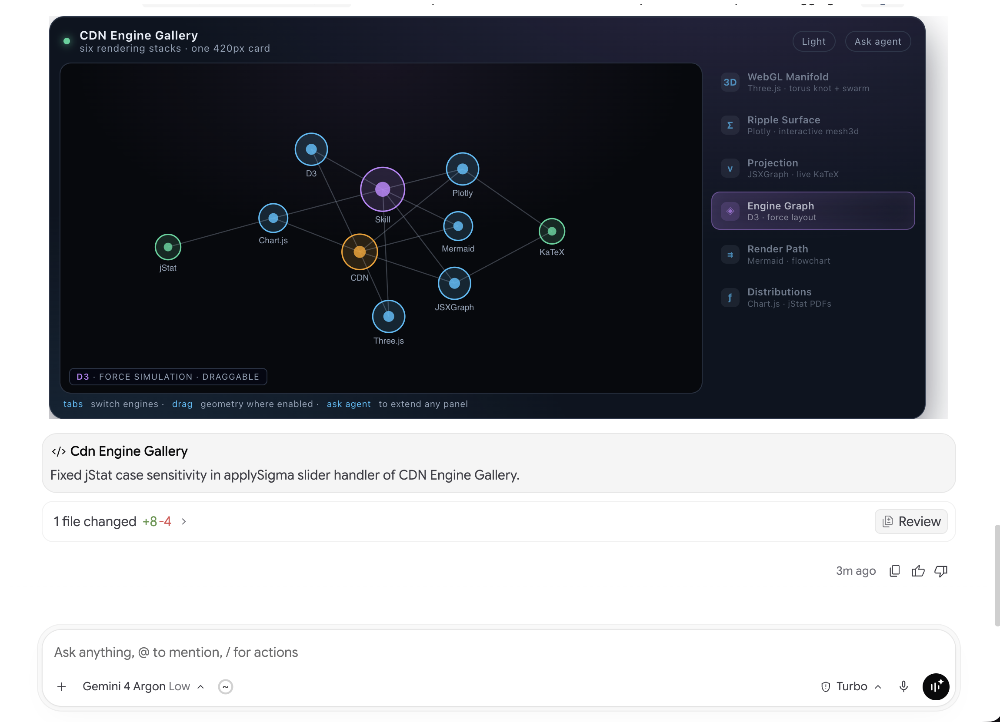
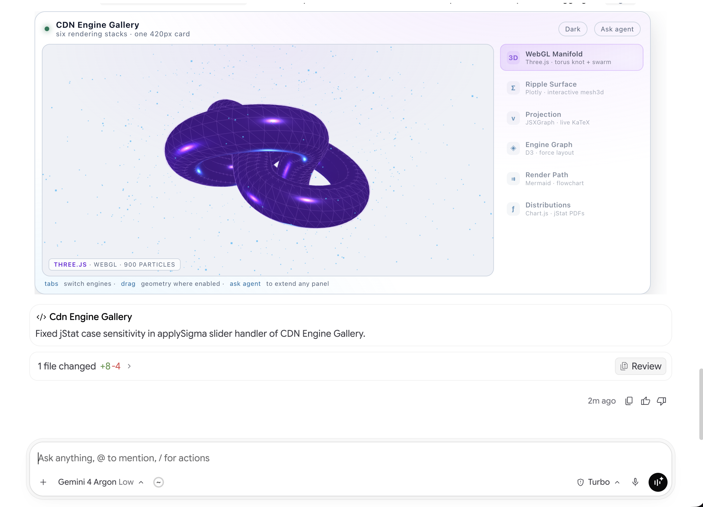
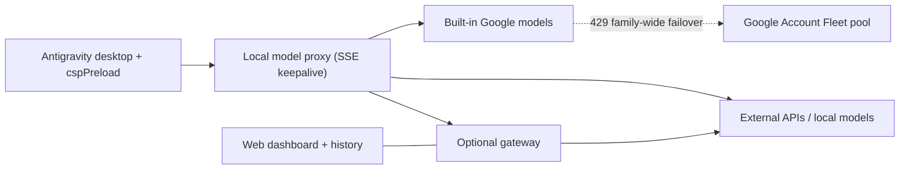

<p align="center">
  
</p>

<h1 align="center">Antigravity Custom Model Enabler — Enhanced Fork</h1>

<p align="center">
  <strong>Your providers. Your local models. Interactive Generative UI. Zero-clutter Fleet failover.</strong><br>
  Advanced model routing, multi-account quota failover, and rich artifact rendering for the Antigravity desktop app, Antigravity IDE, and optional gateway.
</p>

<p align="center">
  <a href="https://github.com/prof-slop/antigravity-add-model/actions/workflows/ci.yml"></a>
  <a href="#installation"></a>
  <a href="LICENSE"></a>
</p>

<p align="center">
  <strong>English</strong> · <a href="README_zh.md">简体中文</a> · <a href="README_es.md">Español</a> · <a href="README_tr.md">Türkçe</a> · <a href="README_ru.md">Русский</a> · <a href="README_hi.md">हिन्दी</a> · <a href="README_ar.md">العربية</a>
</p>

<p align="center">
  <a href="#whats-new-in-this-fork"><strong>What's new in this fork</strong></a> ·
  <a href="#generative-ui--csp-relaxation-showcase">Generative UI showcase</a> ·
  <a href="#installation">Quick start</a> ·
  <a href="#quick-links">Quick links</a> ·
  <a href="#syncing-with-upstream">Syncing with upstream</a> ·
  <a href="https://github.com/prof-slop/antigravity-add-model/issues/new">Report an issue</a>
</p>

---

Add external API providers, local models, and multi-account Google Cloud Code quota pools alongside Antigravity's built-in models. Configure them in **Settings**, switch models from the chat picker, render interactive HTML/WebGL artifacts inline, and optionally route requests through a local gateway with history, fallback chains, and a web dashboard.

> [!IMPORTANT]
> The **standalone Electron desktop agent** uses the additive installer below. The separate **VS Code-based Antigravity IDE** uses its own [settings adapter and local web manager](docs/ide.md). Check [compatibility](docs/compatibility.md) before installing.

---

## What's New in This Fork

This repository (`prof-slop/antigravity-add-model`) builds on [`vahapogut/antigravity-add-model`](https://github.com/vahapogut/antigravity-add-model) with opinionated enhancements for power users:

| Enhancement | What it does |
| --- | --- |
| **Generative UI & Artifact Sandbox Unlock (`cspPreload` + [`skills/generative_ui`](skills/generative_ui/SKILL.md))** | Relaxes Content Security Policy (`script-src`, `style-src`, `font-src`, `connect-src`, `worker-src`) and automatically upgrades restrictive `<iframe>` sandboxes (`allow-scripts allow-forms allow-downloads allow-modals`) for rendered HTML artifacts. Enables interactive 3D WebGL (`Three.js`), math graphing (`JSXGraph`, `Plotly.js`), `KaTeX`, `D3`, `Chart.js + jStat`, and external CDNs directly inside Antigravity chat. Includes an optional, ready-to-use [`generative_ui` skill](skills/generative_ui/SKILL.md) for maximum rendering quality. |
| **Family-Wide Native Google Fleet Failover** | A single `google-cloudcode` account pool with **Native Failover** enabled automatically covers **every reasoning-effort variant** in that model family (`low`, `medium`, `high`, `xhigh`, `tiered`, `thinking` — e.g., `gemini-4-argon-low/medium/high` or `gemini-3.8-flash-low/medium/high/tiered`) when your primary IDE account hits a `429` quota limit. |
| **Zero-Clutter Model Selector** | Google Cloud Code Fleet pools configured for background **Native Failover** are automatically hidden from the chat model picker dropdown while remaining active in the background and manageable in **Settings → Custom Models**. |
| **Long-Stream Keepalives & Tool-Call Resilience** | Emits downstream `: keepalive` SSE heartbeats every 5 seconds while buffering large streamed tool-call payloads (e.g., 40 KB `write_file` arguments from high-reasoning models on OpenRouter) and extends streaming request/retry budgets to 15 minutes so slow FP4/thinking endpoints never drop mid-tool-call. |
| **Multi-Turn Reasoning & Subagent Preservation** | Preserves `reasoning_content` / `<thinking>` traces across OpenAI-compatible tool-call round trips and custom `invoke_subagent` routing (`$model`, `customModelId`). |
| **Secret-Free Hardened Vendor OAuth Extraction** | Zero hardcoded `GOCSPX-` client secrets in source or `dist/`. Extracts the personal OAuth credential pair from the local `language_server` binary at runtime using a non-reversible 64-bit SHA-256 pair fingerprint (`6f5c1920f8566f36`) with ordinal fallback, plus dynamic `process.platform` / `process.arch` User-Agent identification. |

---

## Quick links

| Get started | Configure and connect | Help and project |
| --- | --- | --- |
| [Installation](#installation) | [Gateway and web dashboard](#optional-gateway-and-web-dashboard) | [Troubleshooting and recovery](#updates-diagnostics-and-recovery) |
| [Add your first model](#add-your-first-model) | [Connect from another computer](#connect-from-another-computer) | [Supported app versions and layouts](docs/compatibility.md) |
| [Providers and model catalogs](docs/providers.md) | [Model configuration](docs/configuration.md) | [Syncing with upstream](#syncing-with-upstream) |
| [Development and contributing](#development-and-contributing) | [Google account setup](docs/configuration.md#google-cloud-code-account-pools) | [Changelog](CHANGELOG.md) |
| [Antigravity IDE setup](docs/ide.md) | [Source-based feature comparison](docs/feature-parity.md) | [IDE status and restore](docs/ide.md#status-and-recovery) |
| [Cloudflare setup wizard](docs/workers-ai-setup.md) | [Fallback chains](docs/providers.md#fallback-chains-for-rate-limited-providers) | [Local proxy security](docs/compatibility.md#local-proxy-trust-boundary) |

## What you can do

| Capability | Included |
| --- | --- |
| **Manage models** | Provider groups, search, edit, duplicate, enable/disable, model discovery, and keyboard search in the standalone model dropdown. |
| **Connect your providers** | OpenAI, Anthropic, Gemini, OpenRouter, [Cloudflare Workers AI](docs/providers.md#cloudflare-workers-ai), and other compatible APIs; local services such as Ollama, LM Studio, and vLLM. |
| **Render interactive Generative UI** | Inline `<agent-embed>` and artifact HTML widgets with full WebGL, Canvas, SVG, and external CDN script support via `cspPreload`. |
| **Tune requests** | Protocol selection, reasoning settings, context/output limits, custom headers, 15-minute streaming timeouts, SSE keepalives, retries, fallbacks, and circuit breakers. |
| **Choose subagent models** | Clients with `invoke_subagent` support custom child models with isolated routing and preserved reasoning traces. Antigravity IDE can delegate independent text tasks through the [custom-model MCP tools](docs/ide.md#delegate-to-custom-models-with-mcp). |
| **Use Google account pools & family-wide failover** | [Antigravity account sign-in](docs/configuration.md#google-cloud-code-account-pools), collapsible account cards, enable/disable, label editing, removal, and Preferred/Automatic controls. Native failover automatically routes rate-limited native requests (`429`) across all reasoning efforts in the same model family while keeping failover-only pools hidden from the chat selector. [Account controls](docs/configuration.md#quota-panel-and-preferred-accounts). |
| **Estimate visible chat context** | A read-only ring beside a recognized native model selector marks transcript estimates with `~` and unavailable usage with `?`. Hidden prompts, tool definitions and images are excluded. [Scope and limits](docs/configuration.md#native-context-estimate). |
| **Inspect direct requests** | Diagnostics with recent requests, measured latency/token usage, and an explicit small generation test. |
| **Connect Antigravity IDE** | Reversible settings adapter, owned proxy launcher and browser model manager. [Setup](docs/ide.md). |
| **Keep native model selections stable** | Persistent collision-free IDs for model aliases and effort variants, with explicit [native picker capacity](docs/ide.md#native-model-identities-and-capacity). |
| **Share configuration** | Validated JSON/base64 import and exports that omit stored credentials. |
| **Add a web dashboard** | Optional gateway with provider routing, request/session history, replay, charts, and cost estimates. |
| **Connect remotely** | Authenticated gateway access through a tunnel or a configured network endpoint. |

The installer preserves the installed application's runtime and adds validated hooks. It keeps version-specific backups and rolls back failed deployments. See the [feature comparison](docs/feature-parity.md) for implementation details and scope.

## Screenshots

### Generative UI & CSP Relaxation Showcase

With [`src/cspPreload.ts`](src/cspPreload.ts) active, Antigravity's `<agent-embed>` iframes can load external scientific, graphing, and 3D WebGL libraries from public CDNs (**Three.js**, **Plotly.js**, **JSXGraph**, **D3.js**, **Mermaid**, **Chart.js + jStat**, and **KaTeX**) while preserving host sandbox isolation:

<p align="center">
  <a href="assets/showcase_distributions_dark.png">
    
  </a>
  <br>
  <em><strong>Interactive Statistical Dashboards (Chart.js + jStat)</strong> — Zero-flicker in-place dataset mutation driven by a live <code>sigma</code> slider directly inside the chat stream.</em>
</p>

| **D3.js Force-Directed Graph (Dark Mode)** | **Three.js 3D WebGL Manifold (Light Mode)** |
| :---: | :---: |
| <a href="assets/showcase_d3_graph_dark.png"></a> | <a href="assets/showcase_threejs_light.png"></a> |
| *Interactive physics force layout with draggable nodes (`d3@7`).* | *Real-time WebGL torus-knot manifold + 900-particle swarm (`three@0.160.0`) with live theme switching.* |

> [!TIP]
> **Recommended for Maximum Efficacy (Optional):** While [`src/cspPreload.ts`](src/cspPreload.ts) unlocks external CDNs and iframe script execution at the runtime level on its own, Antigravity's built-in system prompt still defaults to conservative static SVG/ASCII fallbacks unless guided otherwise.
>
> For the best out-of-the-box results, install the bundled [`skills/generative_ui`](skills/generative_ui/SKILL.md) skill (which provides the CDN routing matrix, zero-flicker `requestAnimationFrame` update patterns, `<430px` non-scrollable card sizing, and headless snapshot helpers). It is completely **optional**—you can use it as-is, customize it, or write your own skill:
> ```sh
> # Install globally for all workspaces (recommended):
> mkdir -p ~/.gemini/config/skills
> cp -R skills/generative_ui ~/.gemini/config/skills/generative_ui
>
> # Or install per-workspace:
> mkdir -p .agents/skills
> cp -R skills/generative_ui .agents/skills/generative_ui
> ```

---

### Model management

Search your models, organize them by provider, and edit, duplicate, or enable connections from one place.

<p align="center">
  <a href="assets/model_manager.jpg"></a>
</p>

*Current addon controls rendered in an isolated browser demo with illustrative model settings. Click an image to view it at full size.*

### Model editor

Configure a provider and model, choose an API format, or discover available models.

<p align="center">
  <a href="assets/model_editor.jpg"></a>
</p>

### Remote gateway

Save a gateway connection, import model aliases, and open its management dashboard.

<p align="center">
  <a href="assets/remote_gateway.jpg"></a>
</p>

### Gateway dashboard

Map model aliases to providers and configure fallback models and context limits in the optional web panel.

<p align="center">
  <a href="assets/model_gateway.jpg"></a>
</p>

*Current gateway interface in a local test profile; the displayed model mapping is illustrative.*

<details>
<summary><strong>Desktop chat picker — earlier build</strong></summary>

<p align="center">
  
</p>

*Example from an earlier desktop build. Model names and availability depend on your provider and configuration.*

</details>

## Installation

### 1. Get the project and build

You need the **standalone Antigravity desktop app**, Git, and **Node.js 22.13 or newer**. This Node version covers both the desktop addon and the optional gateway.

```sh
git clone https://github.com/prof-slop/antigravity-add-model.git
cd antigravity-add-model
npm ci --ignore-scripts
npm run build
```

Already have the repository? Update your checkout, then run the dependency and build commands again.

Using **Antigravity IDE**? Continue with [IDE setup](docs/ide.md) instead of the standalone installer below. Its basic flow is:

```sh
npm run ide:check -- --resources "/path/to/Antigravity IDE/resources"
npm run ide:apply -- --resources "/path/to/Antigravity IDE/resources"
npm run proxy:start -- --open
npm run ide:launch -- --resources "/path/to/Antigravity IDE/resources"
```

### 2. Check and patch the installed app

Close Antigravity and its language server first. From the repository directory, run:

```sh
node scripts/deploy.mjs --check
node scripts/deploy.mjs
```

The first command checks compatibility without changing the installation. The second applies the addon (and re-signs the app bundle on macOS). Reopen Antigravity after a successful deployment.

If automatic detection cannot find your app, use the same explicit path for both commands:

```sh
node scripts/deploy.mjs --check --resources "/path/to/Antigravity/resources"
node scripts/deploy.mjs --resources "/path/to/Antigravity/resources"
```

`--resources` accepts a Resources directory, an installation directory, or a macOS `.app` directory. Unknown layouts are rejected before application files are replaced.

<details>
<summary><strong>Platform wrappers and the optional Windows endpoint patch</strong></summary>

The wrappers call the same installer and accept the same arguments.

| Platform | Wrapper |
| --- | --- |
| Windows / PowerShell | `./deploy.ps1` |
| macOS standalone app | `bash deploy.sh` |
| Linux | `bash deploy_linux.sh` |

Some recognized Windows language-server binaries bypass the configurable model-list endpoint. For those builds, check and apply the optional binary patch:

```powershell
.\deploy.ps1 --check --patch-language-server
.\deploy.ps1 --patch-language-server
```

This option requires port **50999** and participates in backup/rollback. It is specific to recognized Windows binaries. See [Windows endpoint patching](docs/compatibility.md#optional-windows-language-server-endpoint-patch).

</details>

## Add your first model

1. Open **Settings → Models & Usage** (**Models** in older layouts).
2. In **Custom Models**, select **Add model** and choose a provider.
3. Enter the **API URL** and **API key** when required.
4. Add models using either of the options below, then select a saved model from the chat picker.

| Method | Steps |
| --- | --- |
| **Enter a model manually** | Enter the exact **Provider model ID**, optionally set a display name, then choose **Test connection → Save model**. |
| **Choose from the provider catalog** | Choose **Fetch provider models**, search by name or ID, check models or **Select filtered**, then **Add selected**. |

**Running models locally?** Start your local server first, then choose **Discover local**. Discovery checks common ports only when requested.

**Using Cloudflare Workers AI?** Run `npm run workers-ai:setup -- wizard` for guided account selection, scoped-token creation or an existing token, and model selection. The optional helper encrypts saved credentials and can rotate entries for one account. See [setup, permissions and verification limits](docs/workers-ai-setup.md).

**Moving settings between machines?** Use **Export** and **Import**. Exported configurations omit API keys, custom headers, and Google tokens/client secrets; enter credentials on the receiving machine.

> [!NOTE]
> A successful connection test verifies model listing and authentication. It does not generate a completion or prove that an account has generation quota. Providers without a listing endpoint can still be configured manually.

### Providers and advanced options

| Connection | Examples available in the preset catalog |
| --- | --- |
| Multi-model services | OpenRouter, Together AI, Hugging Face Inference Providers, Fireworks AI, SiliconFlow, Novita AI |
| Direct hosted APIs | OpenAI, Anthropic, Google Gemini, DeepSeek, Groq, Mistral, xAI, Cerebras, SambaNova, Alibaba Cloud Model Studio, NVIDIA NIM |
| Local servers | Ollama, LM Studio, llama.cpp, vLLM, LocalAI, TabbyAPI, Text Generation WebUI |
| Other endpoints | LiteLLM, compatible custom endpoints, or an authenticated model gateway |

Presets fill in defaults; **API format** determines how requests are translated. Model IDs and access depend on the provider. The [provider catalog](src/providers.ts) is the full list.

**Want hundreds of model choices?** OpenRouter and other multi-model services supply live catalogs through **Fetch provider models**. Search and select the models you need; the addon imports available context/output limits and image/reasoning metadata while preserving your explicit overrides. See [provider setup and model discovery](docs/providers.md).

**Using a vision model?** The desktop proxy forwards image inputs to OpenAI-compatible and Anthropic-compatible endpoints, including compatible DeepSeek vision models. See [image input setup](docs/configuration.md#image-inputs) for capability overrides, supported formats and endpoint requirements.

Open **Advanced settings** for request limits, reasoning, headers, fallback models, and other overrides. See the [configuration reference](docs/configuration.md) for field definitions and a sample import.

**Compaction reasoning effort** lets recognized IDE context summaries use `low` or `none` while ordinary chat keeps its own effort. The gateway also has a separate summary-effort setting. See [configuration and model support](docs/configuration.md#compaction-effort).

**Compaction threshold (%)** lets you tune the native IDE's checkpoint threshold while reserving space for model output. Leave it blank to keep the IDE default; see the [85k context example](docs/configuration.md#compaction-threshold).

### Google Cloud Code Fleet & Native Failover

For multi-account Google quota pooling, choose **Google Cloud Code account pool** and follow the [account setup guide](docs/configuration.md#google-cloud-code-account-pools):
- Sign in with **Antigravity account** (credentials are verified at runtime from your installed `language_server` binary) or **My Desktop OAuth client**.
- When **Native Failover** (`nativeFailoverEnabled`) is enabled on a pool (for example, `gemini-4-argon` or `gemini-3.8-flash`), you continue selecting the standard built-in model in the chat dropdown.
- If your primary IDE account exhausts its quota (`429`), the proxy transparently reroutes the request through your secondary pool account—matching **any reasoning effort** (`low`, `medium`, `high`, `tiered`) in that model family.
- Failover-enabled Fleet pools are hidden from the chat model picker so you never see duplicate Fleet entries in your selector.

## Optional gateway and web dashboard

The desktop addon can connect directly to your providers. Add the gateway when you want centralized routing, browser management, request history, or a remote endpoint.

```sh
npm run gateway:install
npm run gateway:build
npm run gateway -- setup --non-interactive
npm run gateway -- start
```

Setup prints the generated gateway token and dashboard login locally. Open **http://127.0.0.1:51001**, sign in, configure provider credentials and model aliases, then save.

In the desktop's **Remote gateway** dialog, enter:

| Field | Local setup |
| --- | --- |
| Gateway URL | `http://127.0.0.1:51000` |
| Gateway token | The token printed by setup |
| Dashboard URL | `http://127.0.0.1:51001` |

Choose **Test gateway**, then **Import model aliases**. The imported models appear in the desktop picker. **Open dashboard** opens the saved dashboard URL.

<details>
<summary><strong>Gateway commands</strong></summary>

```sh
npm run gateway -- status
npm run gateway -- logs
npm run gateway -- stop
```

Provider/model changes saved in the dashboard reload immediately. Listening address and port changes require a restart. History includes prompts, responses, and tool arguments; cost totals are estimates.

</details>

### Connect from another computer

Run the gateway on the host with access to your providers. On the client, forward both ports over SSH:

```sh
ssh -N -L 51000:127.0.0.1:51000 -L 51001:127.0.0.1:51001 user@gateway-host
```

Keep the tunnel open and use the local URLs from the table above. Both gateway listeners bind to loopback by default. For an explicit network listener or HTTPS reverse proxy, see the [remote access guide](gateway/README.md#remote-access).

## How it fits together



The addon injects `customPreload` and `cspPreload` alongside the vendor runtime while preserving all native functionality. The gateway runs as a separate Node process and uses its own data directory.

## Syncing with upstream

This fork tracks [`vahapogut/antigravity-add-model`](https://github.com/vahapogut/antigravity-add-model) as `upstream` while maintaining custom enhancements on `main`. To pull in new upstream releases without losing fork features:

```sh
# 1. Add upstream remote once (if not already present)
git remote add upstream https://github.com/vahapogut/antigravity-add-model.git

# 2. Fetch and rebase our fork commits on top of upstream/main
git fetch upstream
git rebase upstream/main

# 3. Rebuild dist/, run the test suite, and re-deploy
npm run build && npm test && node scripts/deploy.mjs

# 4. Push updated branch to origin
git push --force-with-lease origin main
```

> [!TIP]
> Because `dist/` is tracked in git, if a rebase ever reports conflicts inside `dist/*`, only resolve conflicts in `src/` and run `npm run build` to cleanly regenerate `dist/`.

## Updates, diagnostics, and recovery

After an Antigravity update, rebuild the addon and run the compatibility check again before redeploying.

| Need | Command |
| --- | --- |
| Check the build, model configuration, and local services | `npm run doctor` |
| Get diagnostics as JSON | `npm run doctor -- --json` |
| Check an explicit installation | `npm run patch:check -- --resources "/path/to/Resources"` |
| Reapply the addon to a supported installation | `npm run doctor:repair -- --resources "/path/to/Resources"` |
| Restore this installer's backup | `npm run patch:restore -- --resources "/path/to/Resources"` |
| Inspect a Windows installation before updating | `node scripts/update-preflight.mjs check --resources "C:\path\to\Antigravity\resources" --json` |
| Restore managed changes and stop the owned proxy before updating | `node scripts/update-preflight.mjs prepare --resources "C:\path\to\Antigravity\resources"` |

Close the app before repair or restore. Use the Windows endpoint option when applicable. Restore refuses to overwrite an installation changed by a later upstream update.

| Symptom | Start here |
| --- | --- |
| Installer reports `NOT_SUPPORTED` or `UNSUPPORTED_RUNTIME` | Confirm you have the standalone app and check the [supported layouts](docs/compatibility.md). |
| Black screen after an app update | Follow [startup recovery](docs/compatibility.md#black-screen-after-an-update); avoid restoring an arbitrary older archive. |
| Windows installer keeps asking to close Antigravity | Follow [update preparation](docs/compatibility.md#windows-installer-asks-to-close-antigravity); collect the exact installer error if it persists. |
| A model is missing | Check that it is enabled, saved, and using the correct provider model ID (note: Google Fleet pools with **Native Failover** enabled are intentionally hidden from the chat dropdown). |
| Provider returns 401, 403, or 404 | Check credentials, account access/location, API URL, and model availability. |
| Port 50999 is occupied | A binary-patched Windows install needs that fixed port; ordinary unpatched operation can choose another port. |
| TLS connection fails | Check the endpoint certificate and your trusted CA configuration. |

More details: [compatibility and recovery](docs/compatibility.md) · [model configuration](docs/configuration.md)

## Credentials and data

| Component | Stored data and behavior |
| --- | --- |
| Desktop addon | Models live in `~/.gemini/antigravity/custom_models.json`. Saved API keys, headers, gateway tokens, and Google credentials are encrypted and masked in the editor. |
| Encryption fallback | When OS-backed storage is unavailable, local AES-256-GCM uses `~/.gemini/antigravity/.model-credentials-key`. Keep that key with private backups. |
| Vendor OAuth extraction | Personal Google OAuth credentials are never stored in source code; they are recovered in-memory from the local `language_server` binary using a 64-bit SHA-256 pair fingerprint. |
| Model exports | Stored API keys, custom headers, and Google tokens/client secrets are omitted. Ordinary configuration fields are retained. |
| Optional gateway | Uses its own `~/.gemini/antigravity/gateway` profile. Its credential configuration is separate from Electron storage; history contains request and response content. |

Use **Export** to share model settings. See [data handling](docs/configuration.md#credentials-and-data) and [gateway storage](gateway/README.md#lifecycle-and-data) before copying local profiles.

## Documentation

| Guide | What it covers |
| --- | --- |
| [Configuration reference](docs/configuration.md) | Model fields, import format, Google accounts, and credentials |
| [Providers and model catalogs](docs/providers.md) | Popular services, API endpoints, large-catalog discovery, and account requirements |
| [Cloudflare setup wizard](docs/workers-ai-setup.md) | Account selection, scoped tokens, encrypted model import and account-specific rotation |
| [Gateway guide](gateway/README.md) | Setup, routing, dashboard, lifecycle, and remote access |
| [Compatibility and recovery](docs/compatibility.md) | Supported layouts, updates, backups, and troubleshooting |
| [Feature comparison](docs/feature-parity.md) | Reference repositories, implemented features, and remaining differences |
| [Changelog](CHANGELOG.md) | Current changes and historical release notes |
| [Gateway provenance](gateway/UPSTREAM.md) | Source revision and retained license notices |

## Development and contributing

The desktop addon is TypeScript in `src/`, compiled to the tracked `dist/` directory. The optional gateway has its own package in `gateway/`.

```sh
npm ci --ignore-scripts
npm run build
npm test
npm run lint
```

For gateway or integration changes:

```sh
npm run gateway:install
npm run gateway:build
npm run gateway:test
npm run test:integration
```

CI runs on Windows, macOS, and Linux using local provider fixtures and isolated installation packages. It does not validate live provider credentials or every future Antigravity release.

For a new provider, start with [the desktop preset catalog](src/providers.ts), [protocol registry](src/proxy/registry.ts), and [gateway provider catalog](gateway/src/provider-catalog.ts). Changes should include relevant tests and rebuilt desktop output.

## License and credits

[Apache License 2.0](LICENSE). Adapted gateway components retain their [MIT license](gateway/LICENSE.upstream) and [upstream attribution](gateway/UPSTREAM.md).

Antigravity logo from [Google's official press assets](https://antigravity.google/press).

Fork maintained by **[prof-slop](https://github.com/prof-slop/antigravity-add-model)** · Upstream project by **[vahapogut](https://github.com/vahapogut/antigravity-add-model)**

<p align="center"><a href="#quick-links">↑ Back to quick links</a></p>
